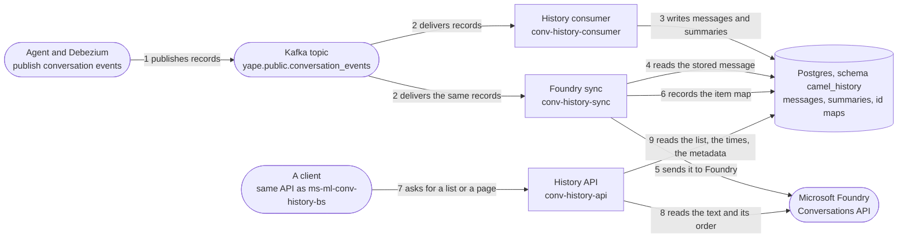
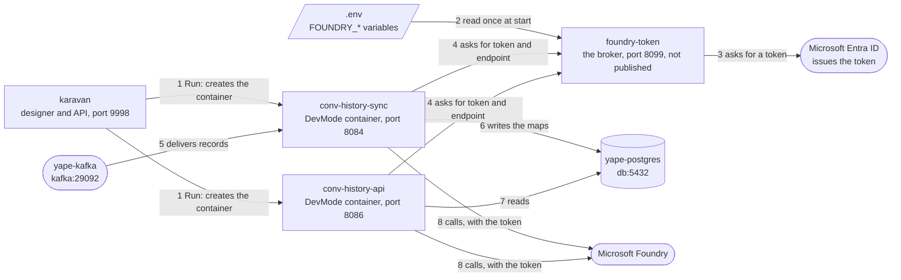
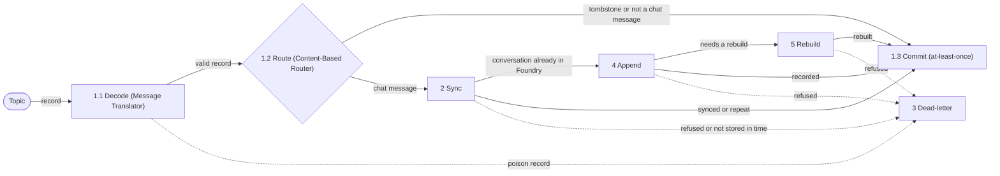
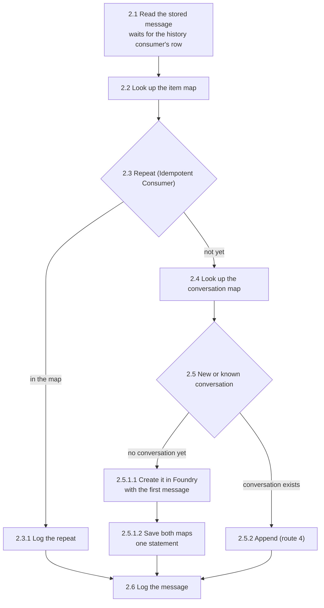
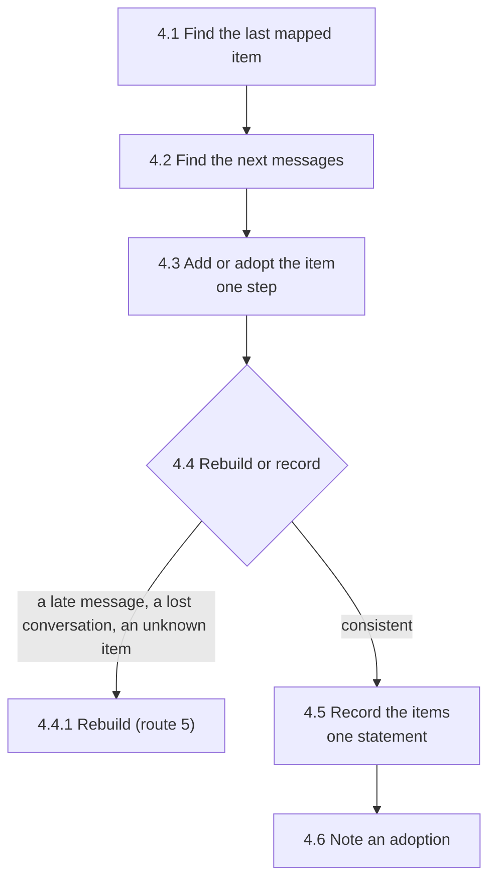
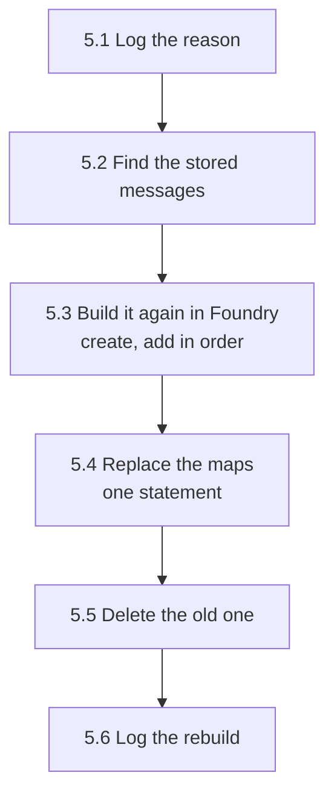
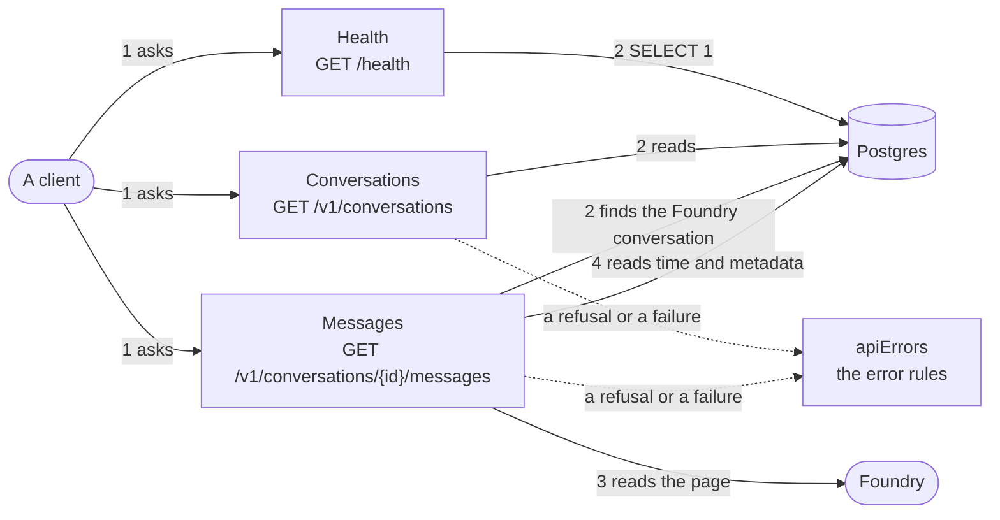
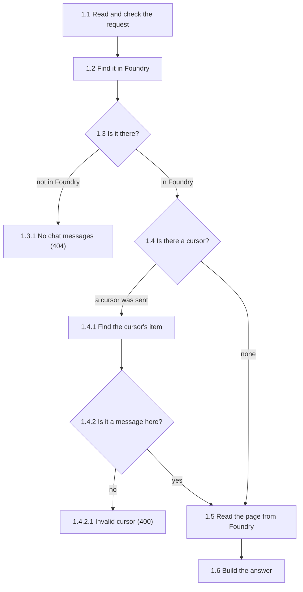
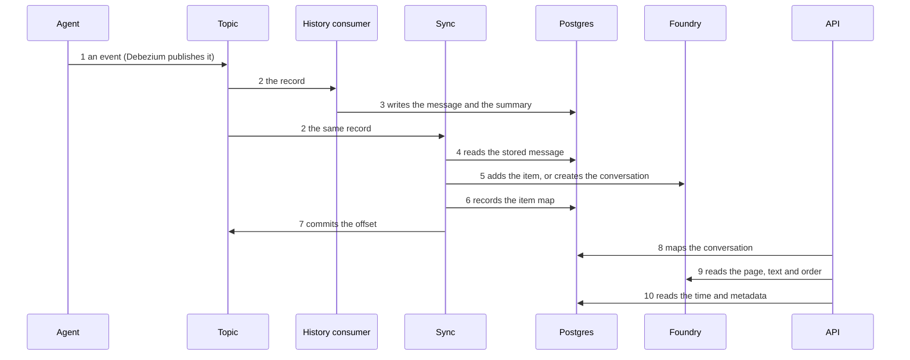

# Design: the Foundry sync and the API

How the history reaches Microsoft Foundry and is served from it, from the big picture down to the steps. It builds on
[design.md](design.md): the **vocabulary and legend there apply here**, with the additions below. Each diagram shows **one
level of detail**, and the numbers and names are the same in every diagram, in the Karavan Designer and in the logs.
Behaviour in words: [conv-history-sync.md](conv-history-sync.md) and [conv-history-api.md](conv-history-api.md). Setting it up:
[foundry-setup.md](foundry-setup.md).

New here? Read Level 1, then "The life of a message". Debugging? Level 2 and the troubleshooting guide. Changing it? Level 3
and the reading map.

## Vocabulary (added)

| Word | Means |
|---|---|
| **chat message** | An event that is a message of the conversation: `UserMessageSent`, `AgentMessageSent` or `GuardrailResponseSent`. The other events are skipped. |
| **item** | A message as Microsoft Foundry stores it: a role and a text, in a Foundry conversation. It has no time and no metadata. |
| **map** | The two tables that tie our ids to Foundry's: `foundry_conversation_map` and `foundry_item_map`. The second is also the sync's inbox. |
| **sync** | Sending each chat message to Foundry once, in order. |
| **reconcile / adopt** | Looking in Foundry for an item that an earlier, lost call kept, and recording it instead of sending it again. |
| **rebuild** | Deleting a conversation in Foundry and creating it again from the stored messages. |
| **orphan** | A Foundry conversation of ours that no map row names. Harmless; `foundry-cleanup-orphans.sh` removes it. |
| **broker** | `foundry-token`: the service that gives the projects a Foundry token, so no secret goes in a project file. |

---

## Level 1: context

*In words:* the topic is the outbox of the event store; each consumer group receives every record, so the history consumer and
the sync read it independently, and a Foundry outage only delays the sync. The consumer writes the stored messages; the sync
sends each chat message to Foundry and records which Foundry item holds it. The API serves the **text and the order from
Foundry** and everything Foundry does not keep (the time, the author, the event, the flow) from Postgres. The list of
conversations of an account comes from Postgres, because Foundry cannot list by account.

---

## Level 2: containers

*In words:* Karavan runs the two projects as containers on the network `yape-local`. A container Karavan starts cannot
receive a secret without it landing in Git, so the secret stays in `.env`, and the broker, a compose service, trades it with
Entra ID for a token that the projects ask for over the network. The broker also tells them the Foundry endpoint.

---

## Level 2: the routes of the sync

*In words:* route 1 decodes a record with the same decoder as the consumer. A chat message goes to route 2, which creates the
Foundry conversation (first message) or hands over to route 4 (the conversation exists). Route 4 reconciles and sends; if
Foundry cannot be repaired by adding, it calls route 5, which builds the conversation again. Then the offset is committed. A
record that can never be sent goes to route 3 (dashed). A Foundry that cannot answer is not a failure path: the step is retried
in place, forever, and the offset does not move.

| Route | File | Called by |
|---|---|---|
| **1 Receive** | `route-receive.camel.yaml` | the topic |
| **2 Sync** | `route-sync.camel.yaml` | step 1.2.2, as `direct:sync` |
| **3 Dead-letter** | `route-error-handling.camel.yaml` | the error rules, as `direct:deadLetter` |
| **4 Append** | `route-append.camel.yaml` | step 2.5.2, as `direct:append` |
| **5 Rebuild** | `route-rebuild.camel.yaml` | step 4.4.1, as `direct:rebuild` |

---

## Level 3: the steps of the sync

### Route 2: one chat message to Foundry, once

*In words:* the text and the role come from the stored row, so Foundry holds the very text our table holds. A message already in
the item map is a repeat and sends nothing. The first message of a conversation creates the Foundry conversation, with our
conversation id in its metadata, and saves both map rows in one statement.

### Route 4: add to a conversation Foundry already has

*In words:* step 4.3 lists the items after the last mapped one and compares them, in order, with the stored messages that
come next. Those that match are **adopted**: an earlier call that was applied but whose answer was lost left them in Foundry.
If the message being handled is not among them, it is sent. Looking and sending are **one step**, because Camel retries only
the step that failed. See [Reconciliation](conv-history-sync.md#reconciliation).

### Route 5: build a conversation again

*In words:* Foundry only appends. A message below the last synced sequence, a conversation Foundry no longer has, or an item
nobody can account for cannot be repaired by adding, so the conversation is created again in Foundry from the
stored messages, in order, and the old one is deleted once the maps point at the new one. See [Rebuilding a conversation](conv-history-sync.md#rebuilding-a-conversation).

---

## Level 2: the routes of the API

*In words:* each endpoint is a REST verb and the route behind it, together in one `endpoint-*.camel.yaml` file. The list reads
Postgres only. The messages read the page from Foundry, then the time and metadata from Postgres. Any refusal or failure goes to
the error rules, which always answer `application/problem+json`: a refusal is a 4xx, a dependency that cannot answer is a 503, a
bug is a 500.

---

## Level 3: the steps of the API

### Messages: one page of a conversation

*In words:* the cursor of a page is the `_id` of a message, which is its sequence; Foundry pages by its own item ids, so step 1.4.1
translates one into the other through the item map. The newest page and the page before a cursor read Foundry in descending order
and turn the result round; the page after a cursor reads ascending.

---

## The life of a message

*In words:* the two consumers read the record at the same time, so the sync waits for the consumer's row before it sends (step
4), a bounded wait. The offset is committed last, so a crash replays the record and every step is safe to repeat.

---

## Reading map

| To understand | Read | Then |
|---|---|---|
| What a chat message is and which ones are sent | Route 1, step 1.2 | the decoder, shared with the consumer |
| Why the sync waits for the consumer | Route 2, step 2.1 | `SyncStore.java` |
| What "once" means with no idempotency key | Route 4, step 4.3 | [Reconciliation](conv-history-sync.md#reconciliation) |
| What a retry repeats | [Error handling](conv-history-sync.md#error-handling) | `route-error-handling.camel.yaml` |
| How a page of messages is built | API route Messages | `MessagePage.java`, `FoundryReader.java` |
| How a cursor works | [The messages](conv-history-api.md#the-messages) | [The conversation list](conv-history-api.md#the-conversation-list) |
| Where a secret lives | [foundry-setup.md](foundry-setup.md) | `scripts/foundry-token-broker/server.py` |

## Pattern map

| Pattern | Where |
|---|---|
| Publish-Subscribe Channel | The topic: the consumer and the sync each get every record |
| Event-Driven Consumer | Route 1, the topic endpoint |
| Message Translator | Step 1.1, the decoder |
| Content-Based Router | The sync's steps 1.2, 2.5 and 4.4; the API's list step 1.2 (the direction), and the messages' steps 1.3 and 1.4 |
| Idempotent Consumer | Step 2.3, with `foundry_item_map` as its inbox |
| Guaranteed Delivery | Step 1.3: the offset moves after the work (at-least-once) |
| Invalid Message Channel / Dead Letter Channel | Route 3 |
| Message Filter | Step 1.2: events that are not chat messages are skipped |
| Pagination with cursors | The list and the messages, with the Link header |
| Compensation | Route 5: build the conversation again when it cannot be repaired |

## Conventions followed

- One `endpoint-*.camel.yaml` file per endpoint, with its `rest` verb and its route together, and the REST verb's `to` a plain
  string: Karavan's Designer opens a file as an integration only when it holds a route, and its REST tab renders only that form.
- Everything else in canonical YAML: `uri: direct` with `parameters`, expressions as `expression: {simple: {expression: ...}}`.
- Project classes are beans (`@BindToRegistry`); the exceptions extend built-in Camel or JDK classes, because a compiled project
  class cannot be named in YAML.
- Settings are `app.*` in `application.properties`, overridable by environment variables; no secret and no Azure resource name
  in a project file.
- Every route and step has a number, a short label (32 characters at most: the Designer draws 32, then `...`) and, when it needs one, a note ending in `Docs:`.
